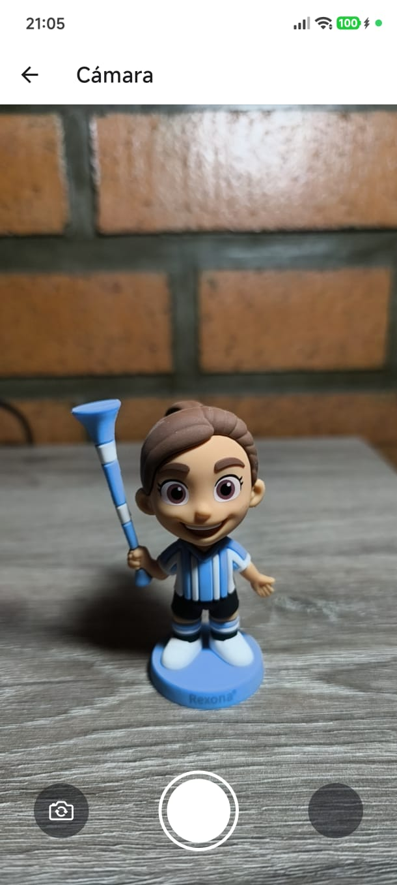
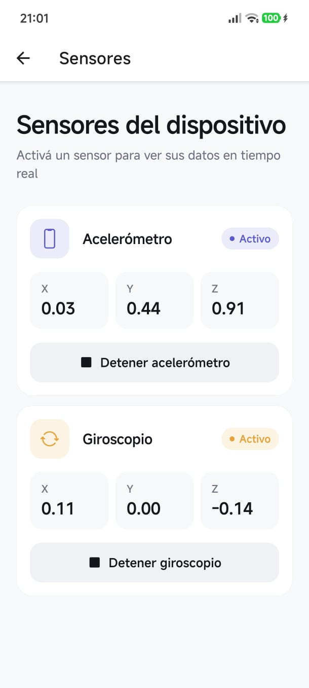
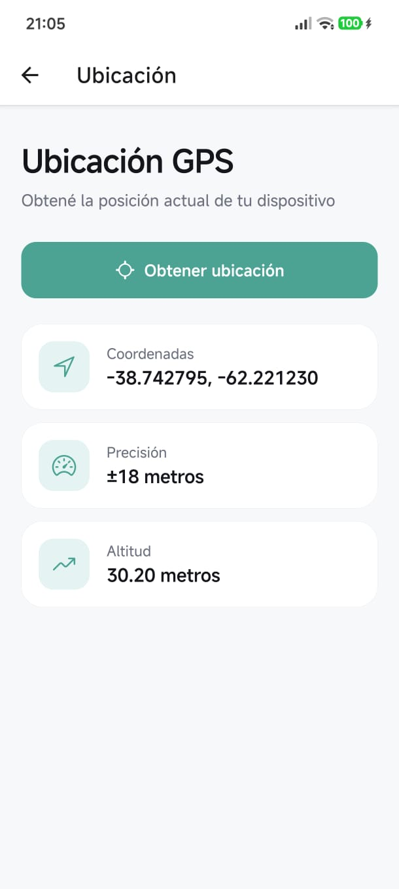

# Capacidades nativas

App de ejemplo hecha con **Expo** y **Expo Router** que muestra cómo usar tres capacidades nativas del celular: cámara, sensores de movimiento y ubicación GPS.

Desde la pantalla de inicio se elige una capacidad y se abre su pantalla de prueba.

## Pantallas

### Inicio · `app/index.tsx`


Menú principal. Muestra una tarjeta por cada capacidad y navega a su pantalla al tocarla. Para agregar una capacidad nueva, se suma un objeto a la lista `capabilities` y se crea el archivo con el mismo nombre dentro de `app/`.

### Cámara · `app/camera.tsx`



Pide permiso de cámara y muestra el visor. Permite tomar una foto, cambiar entre cámara trasera y frontal, y ver la foto tomada para repetirla si hace falta.

Usa: `expo-camera`

### Sensores · `app/sensors.tsx`



Muestra en tiempo real los valores X, Y y Z del **acelerómetro** y el **giroscopio**. Cada sensor se activa y se detiene por separado. Al salir de la pantalla se cancelan las suscripciones para no gastar batería.

Usa: `expo-sensors`

> Los sensores no funcionan en el navegador. En web la pantalla muestra un aviso.

### Ubicación · `app/location.tsx`



Pide permiso de ubicación y, al tocar el botón, obtiene la posición actual una sola vez. Muestra las coordenadas, la precisión en metros y la altitud (si el dispositivo la entrega).

Usa: `expo-location`

## Cómo probarla

```bash
npm install
npx expo start
```

Escaneá el código QR con **Expo Go** en tu celular. Cámara y sensores necesitan un dispositivo real.

Si falta alguna dependencia:

```bash
npx expo install expo-camera expo-location expo-sensors
```

## Estructura

```
app/
├── index.tsx      # Inicio
├── camera.tsx     # Cámara
├── sensors.tsx    # Sensores
└── location.tsx   # Ubicación
docs/              # Imágenes de las pantallas
```

## Estilo

Diseño minimalista con fondo gris claro, tarjetas blancas con borde fino y un color de acento por capacidad:

| Capacidad | Color                                             |
| --------- | ------------------------------------------------- |
| Cámara    | `#F2555D`                                         |
| Sensores  | `#5B5BD6` (acelerómetro) y `#F59E0B` (giroscopio) |
| Ubicación | `#12A594`                                         |
